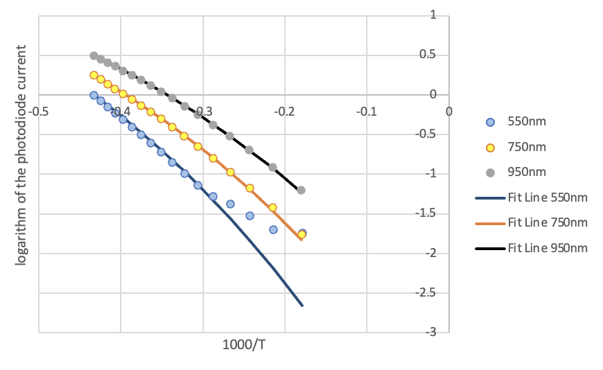

# Blackbody Radiation

## Objective

Test whether blackbody lamp data are consistent with Stefan-Boltzmann behavior and Planck spectral trends.

## Experimental Approach

The original report analyzes lamp voltage/current measurements and photodiode current at selected spectral filters. The raw text data files were preserved from the coursework folder and copied into `data/`.

## Data Analysis

The Excel workbook computes filament resistance and temperature, plots radiated power versus temperature on logarithmic axes, and uses Excel/Solver-style fitting for spectral intensity data. The analysis remains in Excel and has not been rewritten as a Python project.

## Key Results

- The report concludes that radiated power increases approximately with the fourth power of temperature, consistent with Stefan-Boltzmann behavior.
- The spectral-intensity fits support the expected nonlinear Planck-distribution trend.
- The workbook contains an inferred solar temperature of about `6608 K`.
- The report notes that best-fit wavelengths were about 20% larger than the nominal filter bandpasses.

## Methods / Tools

Microsoft Excel, logarithmic transforms, least-squares fitting, nonlinear Solver fitting, voltage/current measurements, photodiode spectral measurements.

## Files

- `report-redacted.docx` — redacted copy of the original report.
- `analysis.xlsx` — renamed copy of `ex2/experiment 2.xlsx`.
- `figures/` — report figures and instrument photos extracted from the original report.
- `data/` — copied raw text data files associated with the blackbody analysis.
