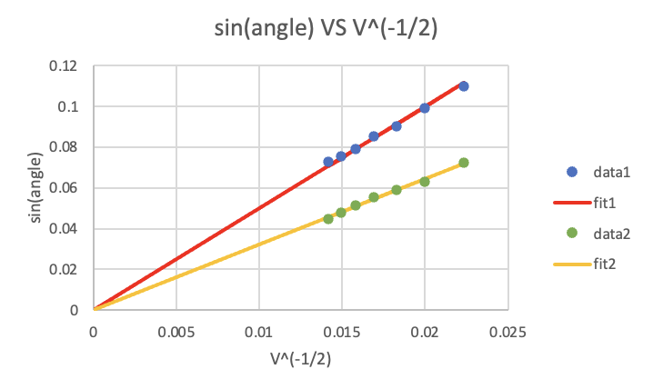

# Electron Diffraction and Crystal Structure

## Objective

Use electron diffraction ring measurements to estimate graphite lattice spacings and compare them with expected crystal-plane values.

## Experimental Approach

The report describes measuring inner and outer diffraction-ring diameters at accelerating voltages from 2.0 kV to 5.0 kV. Ring diameters were marked on Mylar film and measured for the analysis.

## Data Analysis

The Excel workbook converts ring diameters into diffraction angles and fits `sin(theta)` against `V^(-1/2)`. The fitted slopes are then used to estimate lattice spacings.

## Key Results

- The workbook estimates lattice spacings of about `0.123 nm` and `0.191 nm`.
- The expected values listed in the workbook are `0.123 nm` and `0.213 nm`.
- The report concludes that the outer-ring estimate agreed closely, while the inner-ring estimate deviated more substantially.

## Methods / Tools

Microsoft Excel, linear fitting, electron diffraction, Bragg-style lattice-spacing estimation.

## Files

- `report-redacted.docx` — redacted copy of the original report.
- `analysis.xlsx` — renamed copy of `ex5/ex5.xlsx`.
- `figures/` — report figures and instrument photos extracted from the original report.
