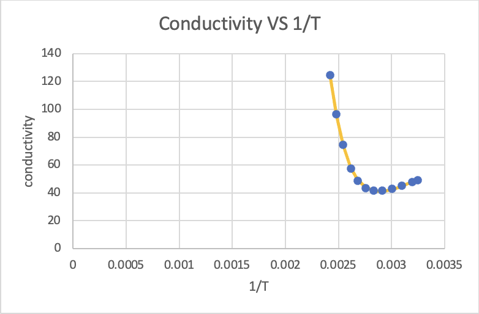

# Hall Effect and Semiconductor Conductivity

## Objective

Measure Hall voltage and temperature-dependent conductivity in germanium to study semiconductor carrier behavior.

## Experimental Approach

The report measures Hall voltage as a function of current for two magnetic-field orientations. It also records Hall voltage and voltage across the germanium crystal during cooling.

## Data Analysis

The Excel workbook fits Hall voltage versus current and computes conductivity from the measured voltage across the germanium sample. The report describes using a nonlinear least-squares approach in Excel to estimate the germanium band gap.

## Key Results

- The Hall-voltage fits have opposite signs when the magnetic-field direction is reversed.
- The report infers a negative effective carrier sign.
- The workbook estimates a germanium band gap of about `0.990 V`, compared with an accepted value of about `0.67 V` noted in the report.

## Methods / Tools

Microsoft Excel, Hall-effect measurement, linear fitting, conductivity calculation, nonlinear least-squares fitting.

## Files

- `report-redacted.docx` — redacted copy of the original report.
- `analysis.xlsx` — renamed copy of `ex10/experiment 10.xlsx`.
- `figures/` — report figures extracted from the original report.
