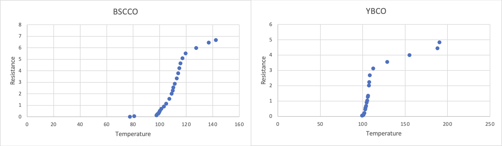

# High-Temperature Superconductivity

## Objective

Observe high-temperature superconducting behavior through the Meissner effect, resistance-temperature transitions, and persistent-current behavior.

## Experimental Approach

The report describes levitation observations with superconducting samples and liquid nitrogen. It also measures resistance versus temperature for BSCCO and YBCO samples and observes compass displacement from a persistent current.

## Data Analysis

The Excel workbook converts measured voltages into sample resistance and temperature using the thermocouple calibration formula. The report then interprets resistance-temperature curves to estimate the superconducting transition.

## Key Results

- The report estimates a superconducting transition temperature near `110 K`.
- The persistent-current observation records a compass displacement of about `30 degrees`.
- The report notes that sample nonuniformity and temperature-control limitations affected the transition curves.

## Methods / Tools

Microsoft Excel, resistance-temperature analysis, thermocouple calibration, superconducting transition interpretation.

## Files

- `report-redacted.docx` — redacted copy of the original report.
- `analysis.xlsx` — renamed copy of `ex11/ex11.xlsx`.
- `figures/` — report figure extracted from the original report.
