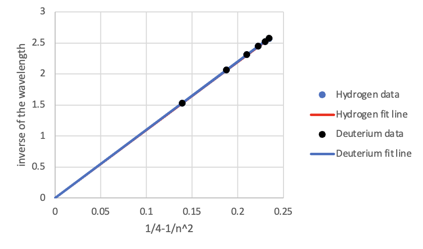

# Hydrogen/Deuterium Spectroscopy

## Objective

Measure Balmer-series spectral lines for hydrogen and deuterium, estimate Rydberg-fit behavior, and examine the H-alpha isotope shift.

## Experimental Approach

The report uses hydrogen and deuterium discharge tubes with a Vernier spectrometer. It records multiple spectral runs around Balmer lines and additional H-alpha measurements around 656 nm.

## Data Analysis

The Excel workbook identifies local peak positions, fits inverse wavelength against the Balmer-series term, and fits averaged H-alpha intensity curves for hydrogen and deuterium.

## Key Results

- The workbook contains Rydberg-fit slopes of about `10.988` for hydrogen and `10.997` for deuterium in the workbook's inverse-wavelength scale.
- The report concludes that the Balmer formula is supported by the measured line positions.
- The H-alpha analysis observes a small hydrogen-deuterium shift; the report states that the resulting mass-ratio estimate had significant deviation from the expected value.

## Methods / Tools

Microsoft Excel, spectral peak estimation, linear fitting, nonlinear fitting, isotope-shift analysis.

## Files

- `report-redacted.docx` — redacted copy of the original report.
- `analysis.xlsx` — renamed copy of `ex6/ex6.xlsx`.
- `figures/` — report figures extracted from the original report.
