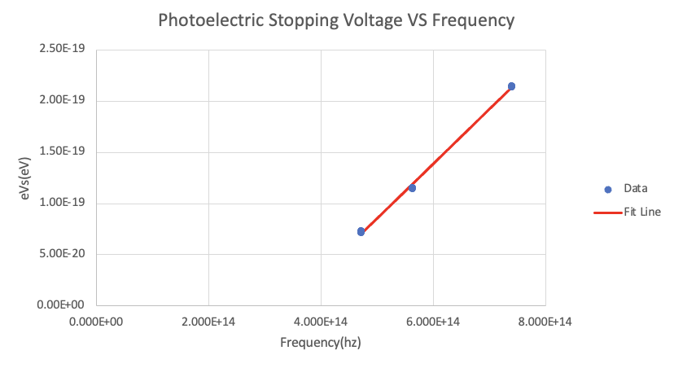

# Photoelectric Effect

## Objective

Measure stopping voltage for several laser wavelengths and use the relationship between stopping voltage and frequency to estimate Planck's constant.

## Experimental Approach

The report uses a photoelectric-effect apparatus, three laser wavelengths, and a neutral-density filter. Measurements compare photocurrent as a function of retarding voltage with and without intensity reduction.

## Data Analysis

The Excel workbook computes photocurrent from measured anode voltage, fits current-retarding-voltage curves to estimate stopping voltages, and fits stopping voltage versus incident-light frequency.

## Key Results

- Estimated stopping voltages in the workbook are approximately `0.450 V`, `0.721 V`, and `1.340 V` for the three laser wavelengths.
- The report concludes that the neutral-density filter changes intensity but does not substantially shift stopping voltage.
- The workbook estimates Planck's constant as `5.36e-34 J s`; the original report states that this is below the accepted value and discusses limited wavelength coverage as a source of error.

## Methods / Tools

Microsoft Excel, curve fitting, matrix-based linear fit, stopping-voltage estimation, photocurrent calculation.

## Files

- `report-redacted.docx` — redacted copy of the original report.
- `analysis.xlsx` — renamed copy of `ex3/X3_data_worksheet.xlsx`.
- `figures/` — report figures and instrument photos extracted from the original report.
