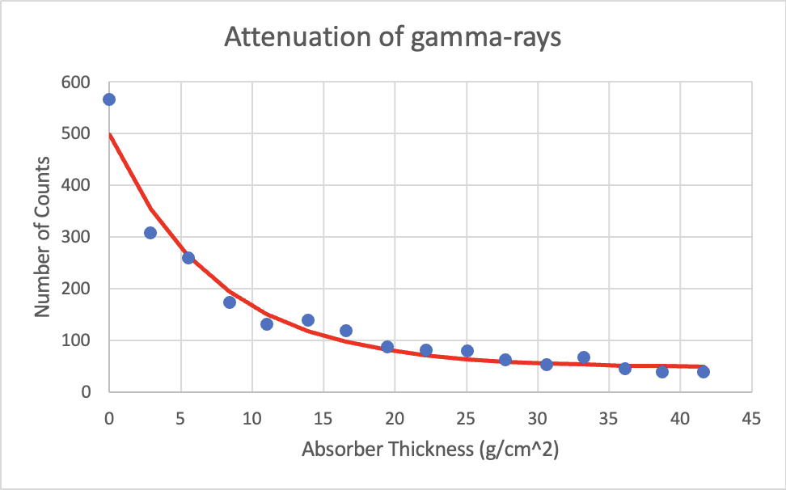

# Radioactivity

## Objective

Measure alpha, beta, and gamma attenuation behavior using Geiger-counter count-rate data.

## Experimental Approach

The report measures alpha-particle range in air, beta attenuation through polyethylene and aluminum absorbers, and gamma attenuation through tungsten disks.

## Data Analysis

The Excel workbook corrects count rates, converts absorber thickness to areal density, and fits gamma attenuation with an exponential decay plus background model.

## Key Results

- The report estimates an alpha range cutoff of about `0.0048 g/cm^2`, within the NIST comparison range cited in the report.
- The beta endpoint absorber thickness is estimated at about `0.7 g/cm^2`.
- The workbook estimates a gamma attenuation coefficient of about `7.51`; the report compares this with a NIST value of `7.98`.

## Methods / Tools

Microsoft Excel, Geiger counting, count-rate correction, absorber areal density conversion, exponential fitting, Poisson-statistics discussion.

## Files

- `report-redacted.docx` — redacted copy of the original report.
- `analysis.xlsx` — renamed copy of `ex12/ex12.xlsx`.
- `figures/` — report figures extracted from the original report.
